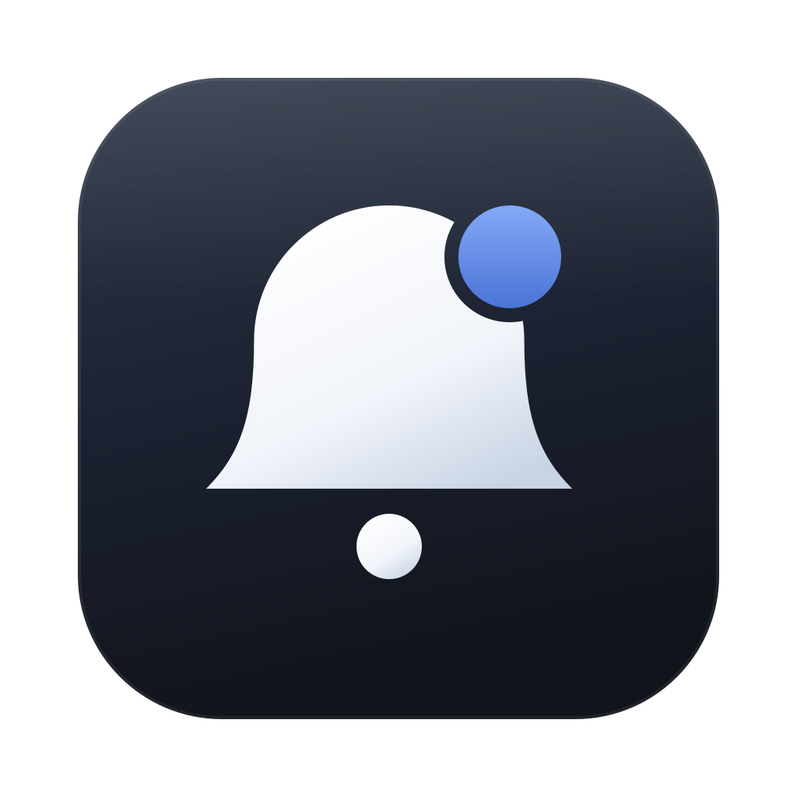
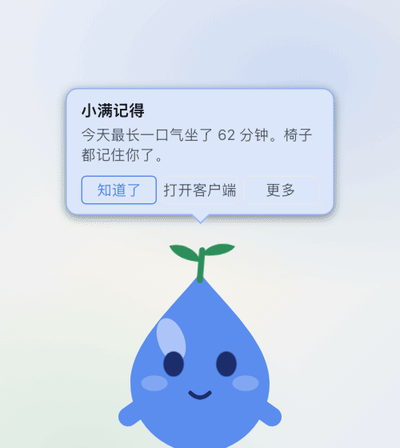
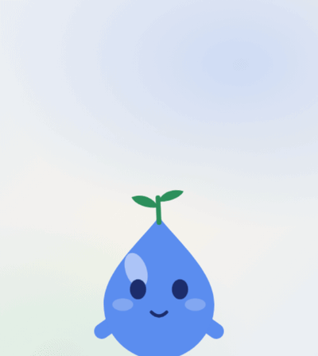
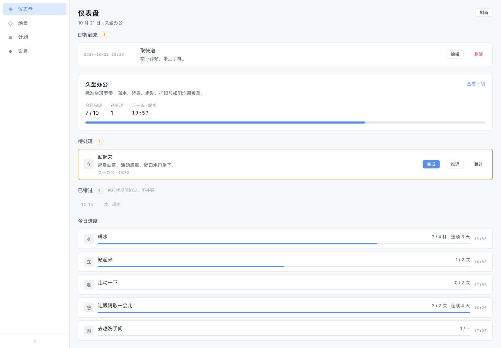
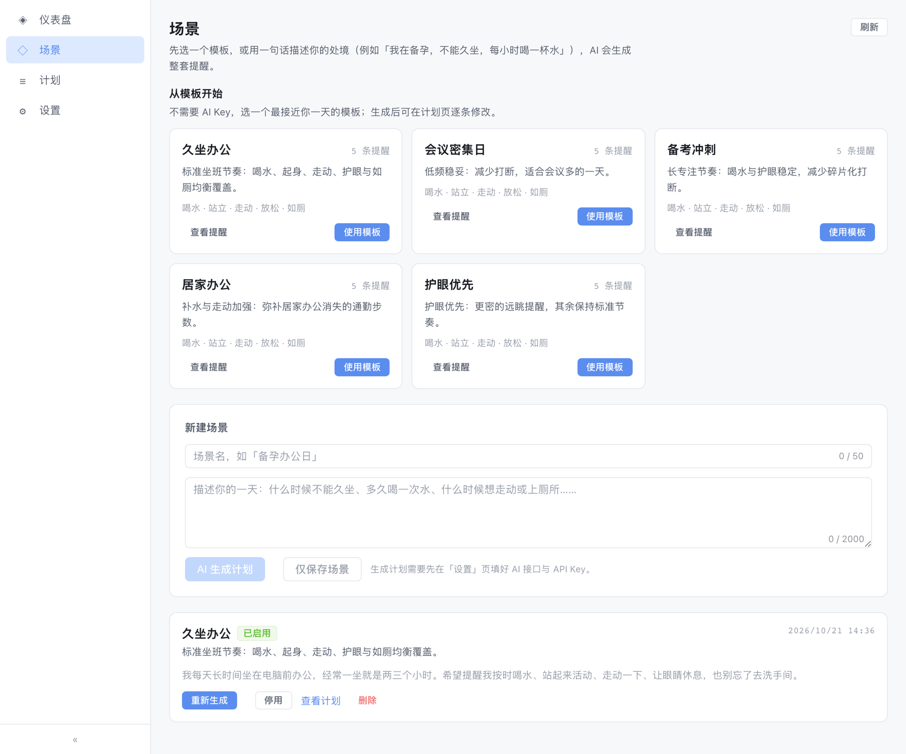
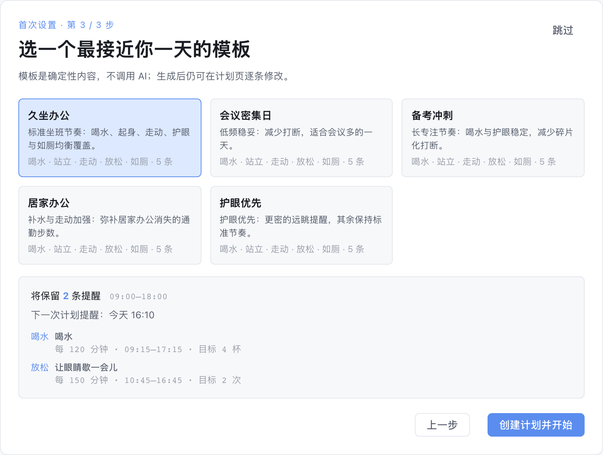
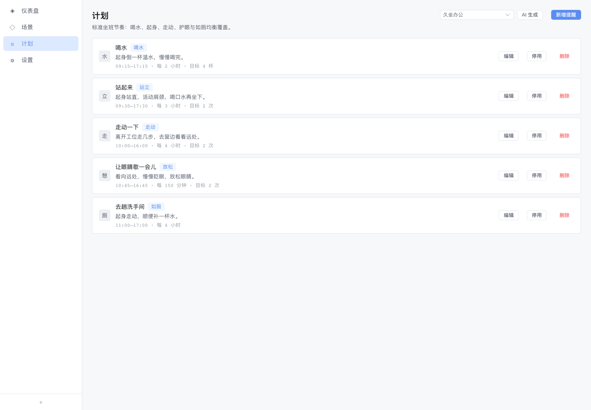
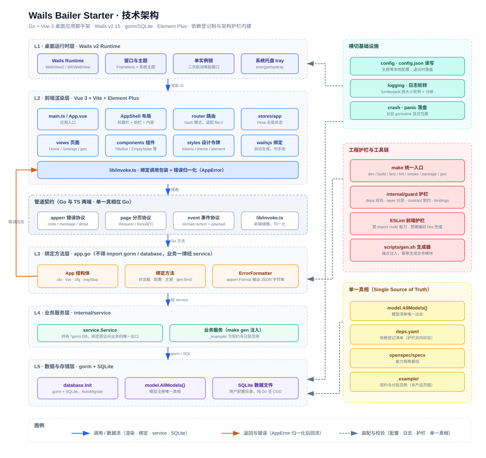

<div align="center">



<h1>Morrow</h1>

<p><strong>A local-first wellness app, carried by a desktop pet.</strong><br>
Morrow reminds you to drink, stand, move and look away — 小满, a small water-drop pet with a sprout on its head, delivers the message and grows with your daily progress.<br>
<sub>本地优先的桌面健康提醒应用。提醒由一只叫「小满」的桌面宠物承载：一滴水，头顶一株芽，芽随坚持的天数生长。</sub></p>

<p>
  <a href="https://github.com/Benny66/morrow/releases/latest"></a>
  <a href="https://github.com/Benny66/morrow/releases/latest"></a>
</p>

<p><sub>界面目前只有中文 / The app UI is currently Chinese-only.</sub></p>

<p>
  <a href="https://github.com/Benny66/morrow/actions/workflows/build.yml"></a>
  
  
  
  
  <a href="LICENSE"></a>
</p>

<p>
  <a href="#download">下载 / Download</a> ·
  <a href="#why-morrow">为什么 Morrow</a> ·
  <a href="#features">功能</a> ·
  <a href="#screenshots">界面</a> ·
  <a href="#quick-start">源码构建</a> ·
  <a href="#architecture">架构</a> ·
  <a href="#privacy">隐私</a> ·
  <a href="#docs">文档</a>
</p>

<p align="center">
  
</p>
<p align="center"><sub><b>小满 / Xiaoman</b> · 它记得你今天坐了多久，也会在你点它时挥手；到点还会主动开口提醒你起身。<br>10 秒无声演示 / A 10-second silent demo.</sub></p>

</div>

<a id="download"></a>
## 下载 / Download

| 平台 / Platform | 安装包 / Installer | 说明 / Notes |
|---|---|---|
| macOS 11+ | [最新版 .dmg](https://github.com/Benny66/morrow/releases/latest) | Universal（Apple Silicon + Intel） |
| Windows 10/11 | [最新版 .exe](https://github.com/Benny66/morrow/releases/latest) | NSIS 安装器 |

无账号、无云同步；提醒、打卡、统计与久坐数据都留在本机。

> **macOS 首次打开 / First launch on macOS**：安装包尚未做 Apple 公证（notarization）。若系统提示「已损坏，无法打开」，请右键 App →「打开」，或执行
> `xattr -dr com.apple.quarantine /Applications/Morrow.app`。
> 这不是安装包损坏，而是 Gatekeeper 对未公证应用的默认拦截；正式分发需要 Apple Developer ID 与 notarization。

<a id="why-morrow"></a>
## 为什么 Morrow / Why Morrow

- **本地优先 / Local-first**：SQLite 本地落盘，无账号、无云同步；提醒、打卡与统计全部留在本机。AI 只在主动使用相关功能时调用你配置的端点。
- **宠物承载 / Carried by a pet**：不是又一个计时器。小满默认是**毒舌健康搭子**，在桌面上陪你完成每一次喝水、起身与远眺；也能根据连续用机与行为类别，在合适的时候开口（或闭嘴），芽随坚持的天数生长。
- **零配置起步 / Zero-config start**：内置 5 个场景模板，干净安装后四步就能得到一套可编辑、可启用的计划。AI 是可选的自定义入口，不是前置条件。
- **日常保健边界 / General wellness, not medical advice**：只覆盖喝水、起身、走动、用眼放松、如厕等办公日常；不做疾病诊断、用药或医疗建议。

<a id="features"></a>
## 功能 / Features

### 提醒与计划 / Reminders & Plans

- **周期性提醒 / Recurring reminders**：每天在指定时段内按间隔重复，例如「09:00–18:00 每小时喝水」。
- **每日单点 / Daily single-point**：每天同一时刻只响一次（`interval_min = 0`），不会因「完成」而永久停用。
- **一次性提醒 / One-off reminders**：指定绝对日期与时刻，只触发一次。独立于场景启停，错过不跨日补发，但在首页保留可见条目。
- **自然停顿顺延 / Natural pause deferral**：周期性、每日单点与推迟到点的提醒，到点时若你正在键鼠输入，最多顺延 60 秒；停手后投递。到上限仍在输入时改为安静投递（通知 + 宠物 + 待处理，不弹全屏、不进休息模式）。一次性提醒保持绝对时刻，不顺延。可在设置中关闭或改为 30 秒。
- **六种类型 / Six kinds**：喝水 / 站立 / 走动 / 如厕 / 护眼放松 / 其他，决定图标、进度量词与休息引导。

### 场景模板与首次引导 / Templates & Onboarding

- **五个内置模板 / Five built-in templates**：久坐办公、会议密集日、备考冲刺、居家办公、护眼优先。每个模板都覆盖五类关注目标（喝水 / 站立 / 走动 / 用眼放松 / 如厕），靠间隔与时段体现差异。
- **确定性内容 / Deterministic content**：模板是只读定义，不调用 AI、不需要 Key、离线可用。选用即复制成普通场景，副本可编辑、可启用、可删除；模板更新不回溯已有副本。
- **四步首次引导 / Four-step onboarding**：干净安装后依次选择工作时段、最想解决的两件事、模板，以及「久坐感知」：显式选择开启应用画像或只使用基础检测。应用按工作时段裁切提醒窗口、按目标保留提醒，完成后自动启用。已有场景的升级用户不会看到引导，而是在首页看到一次性画像同意卡。
- **AI 仍可选 / AI remains optional**：场景页保留「AI 生成计划」；模板负责零配置起步，AI 负责个性化。

### 智能免打扰 / Smart Pause

到点时若用户不该被打扰，自动顺延、不补发。六路信号可逐项开关：

| 信号 / Signal | 触发条件 / Trigger | 默认 / Default |
|---|---|---|
| 空闲 / Idle | 连续 3 / 5 / 10 分钟无键鼠输入 | 开，5 分钟 |
| 锁屏 / Lock | 屏幕锁定或系统休眠 | 开 |
| 会议 / Meeting | Zoom / Teams / Webex / 腾讯会议 / 飞书 / 钉钉 / FaceTime 在前台 | 开 |
| 全屏 / Fullscreen | 前台窗口铺满当前显示器 | 关 |
| 专注模式 / Focus | macOS 系统专注开启（12+） | 关 |
| 日历忙闲 / Calendar | macOS 日历当前处于忙碌时段 | 关 |

暂停期间：

- 周期性提醒**顺延不补发**，恢复后按原间隔重新计时；
- 每日单点与一次性提醒记为「已错过」，在首页保留可见、不补弹。

感知只用本机活跃度与前台应用身份：不采集屏幕内容、不读日历事件标题/参与人/备注/地点、不上传。

### 演示模式 / Presentation Mode

菜单栏或全局快捷键可进入/退出演示模式：

- 暂停提醒投递；隐藏桌宠、气泡与强提醒遮罩；
- 在系统支持时把桌宠与遮罩排除出屏幕共享/录屏（macOS / Windows；Linux 降级）；
- 会议应用或全屏持续 5 秒后，宠物会建议进入；经建议进入的会在会议/全屏消失 30 秒后自动退出，手动进入的保持到手动退出；
- 退出后不补弹演示前的待处理；新到点提醒照常；
- 不读取屏幕内容与窗口标题，不检测摄像头或麦克风。

### 休息模式 / Rest Mode

站立 / 走动 / 护眼三类提醒在到点前 60 秒给出预警（宠物气泡 + 菜单栏），到点进入倒计时覆盖层，展示与类型匹配的内置引导动作：

| 类型 / Kind | 时长 / Duration | 引导方向 / Cue |
|---|---|---|
| 护眼放松 / Rest | 60 秒 | 远眺 + 呼吸 |
| 站立 / Stand | 120 秒 | 肩颈拉伸 |
| 走动 / Move | 180 秒 | 起身走动 |

倒计时结束自动记「完成」；提前结束可选「算完成」或「跳过」。喝水 / 如厕 / 其他保持简单打卡。引导内容内置，离线可用，不调用 AI。

### 久坐感知与毒舌健康搭子 / Sit Awareness & Sassy Companion

- **全局久坐时钟 / Global sit clock**：连续用机时间全局累计，切换应用不重置；分级空闲、锁屏/休眠与主动休息按规则暂停或清零。不是给每个应用单独算健康计时。
- **应用使用画像（可选）/ App usage profile (opt-in)**：显式同意后，每 5 秒读取前台应用身份，只落会话级记录（应用、起止、时长、派生类别），不读窗口标题、屏幕内容或键鼠输入内容。数据只存本机，可随时关闭、清空或按日核对。
- **更合适的开口时机 / Better timing**：默认 60 分钟软提醒（45/60/90 可调），临近正式站立/走动提醒时不抢跑；应用画像开启时，同一应用连续专注 10 分钟或短暂切走 2 分钟宽限内不打断，切出并停顿后再按规则开口。
- **真实休息与目标抵扣 / Breaks & credit**：主动休息、满足门槛的锁屏或长空闲视为真实休息；主动休息与合格锁屏可抵扣当前场景最近到点的站立/走动目标，首页进度 +1。一个久坐会话最多抵扣一次。
- **记忆与三档语气 / Memory & tones**：基于类别级事实与完整统计生成软提醒附注或独立记忆气泡（每天最多 5 次主动发言、至少间隔 30 分钟）；默认毒舌，可切活泼/温和，气泡里「别这样说」立即转温和并持久化。所有文案本地模板生成，不调用 AI，不出现应用名。
- **久坐页 / Sit page**：今日/7 天/按日查看连续用机、最长、休息、抵扣、站立/走动目标、应用明细与类别分布；支持类别纠正、关闭画像时保留/删除历史、清空应用与久坐数据（保留 CheckIn 与连续天数），以及导出时选择是否包含应用画像。

### 场景与 AI / Scenarios & AI

- **场景 / Scenario**：一段自然语言描述的处境（如「备孕办公日」），是周期性计划的组织单位；同一时刻至多启用一个。
- **AI 计划 / AI plan**：由场景生成整套周期性提醒，逐条可编辑。
- **快速添加 / Quick add**：在首页输入文字或附加图片/文件，AI 解析为一次性或周期性草稿；先预览、逐条确认，再落库。

### 打卡与进度 / Check-ins & Progress

- 完成 / 跳过 / 推迟（默认 5 分钟，可调 1–120）。
- 首页：待处理、已错过、今日进度、下一次触发倒计时。
- 计划页：每条提醒的今日进度与连续达标天数。

### 桌面与系统集成 / Desktop & System Integration

- **桌面宠物 / Desktop pet**：透明置顶小窗常驻桌面。待处理时进入等待、清空后庆祝、休息时陪做；芽的形态按「累计完成天数」分五档、跨天不回退，今日完成率只影响神态；空闲时会有张望/伸懒腰这类小动作，离开久了会打盹、回来先"惊一下"。右键宠物可换形象、调缩放、今天先这样、打开主窗或隐藏；支持导入素材包。
- **菜单栏 / Menu bar**：显示今日完成/目标、下一条提醒时间、待处理数量，以及暂停或休息原因；提供「打开主窗」「查看待处理」「进入/退出演示模式」「退出」。
- **强提醒 / Strong alert**：到点在全屏遮罩上展示待处理卡片，覆盖所有显示器；主屏显示完整操作，副屏显示简化卡片。桌宠与遮罩默认排除出屏幕捕获。
- **其他 / Other**：静默时段（默认 22:00–08:00）、系统通知、开机自启、唤起主窗与演示模式全局快捷键、明暗主题、数据库导出与恢复。

<p align="center">
  
</p>
<p align="center"><sub>点气泡里的「完成」即可处理提醒，不必打开主窗口；清空待处理后小满会跳一下。</sub></p>

### 本地优先 / Local-first

SQLite 本地落盘，无账号体系。只有主动使用 AI 功能时才访问你配置的端点；其余能力全部离线可用。

<a id="screenshots"></a>
## 界面 / Screenshots

### 仪表盘 / Dashboard

<p align="center">
  
</p>
<p align="center"><sub>当前计划、待处理提醒、今日进度与下一次触发，一屏读完。</sub></p>

### 场景模板库 / Template library

<p align="center">
  
</p>
<p align="center"><sub><b>场景模板库</b> · 5 个内置模板，每个包含 5 类提醒；一键复制为可编辑场景，默认停用。</sub></p>

模板是确定性内容：不需要 AI Key，也不联网。选中一个模板即可得到一套完整的提醒副本，之后在计划页逐条修改；「AI 生成计划」仍然保留，作为更个性化的自定义入口。

### 首次引导 / Onboarding

<p align="center">
  
</p>
<p align="center"><sub><b>首次引导</b> · 工作时段 + 两个关注目标 + 模板 + 久坐感知同意，实时预览保留的提醒与下一次触发。</sub></p>

引导只出现在干净安装且没有场景时。工作时段只用于裁切本次生成的提醒窗口；关注目标只用于保留所选类型的提醒；久坐感知页显式选择应用画像或基础检测；完成或跳过都会写入完成标记，之后不再出现（跳过时画像同意卡会在首页补一次）。

### 可编辑的计划 / Editable plan

<p align="center">
  
</p>
<p align="center"><sub><b>计划页</b> · 每条提醒的间隔、时段与每日目标都可以逐条调整。</sub></p>

AI 只负责生成一次，之后完全本地可控：模板副本与 AI 计划都落在同一张计划页里，可编辑、停用、删除，也可以随时手动新增一条。

<a id="quick-start"></a>
## 源码构建 / Build from source

> 只想使用？直接下载[上方安装包](#download)。以下步骤只用于开发与贡献。

### 环境要求 / Prerequisites

| 依赖 / Dependency | 版本 / Version | 说明 / Notes |
|---|---|---|
| Go | ≥ 1.26 | `go version` 确认 |
| Node | ≥ 20 | `node --version` 确认 |
| Wails CLI | v3，与 `go.mod` 对齐（当前 `v3.0.0`） | `go install github.com/wailsapp/wails/v3/cmd/wails3@v3.0.0` |
| 平台依赖 | — | Windows 需 WebView2；Linux 需 GTK4 + WebKitGTK 6.0 |

### 运行 / Run

```bash
make dev       # 开发态（含前端热更新）
make build     # 编译当前平台产物
make test      # Go 测试（含架构护栏）
make lint      # gofmt + 护栏 + go vet + ESLint + vue-tsc
```

根包用 `//go:embed` 内嵌 `frontend/dist`，该目录不入库。首次检出先跑一次
`cd frontend && npm install && npm run build`（或直接 `make dev`）；`make test` / `make lint`
会检测缺失并提示。

### 常用命令 / Commands

| 命令 / Command | 作用 / Purpose |
|---|---|
| `make dev` | 开发态，前端热更新 |
| `make build` | 编译当前平台产物 |
| `make test` | Go 测试与架构护栏 |
| `make lint` | 静态检查（gofmt / Go 护栏 / go vet / ESLint / vue-tsc） |
| `make smoke` | 冒烟测试（构建 → 启动 → 断言 → 清理） |
| `make package` | 真安装包（`make package os=macos\|windows\|linux`） |
| `make install` | 构建并安装到本机 `/Applications`（macOS） |
| `make icon` | 从 `build/icon/appicon.svg` 重新生成三平台图标 |

### 数据与配置 / Data & Config

应用数据目录（数据库、配置、日志同处）：

| 平台 / Platform | 路径 / Path |
|---|---|
| macOS | `~/Library/Application Support/Morrow/` |
| Windows | `%AppData%\Morrow\` |
| Linux | `~/.config/Morrow/` |

目录内主要是 `Morrow.db`、`config.json`、`app.log`。设置页会显示实际路径，并提供数据库导出与恢复。

> AI 的 API Key 以明文保存在 `config.json`。不要把数据目录提交进仓库或随手分享；
> 需要备份时优先使用设置页的数据库导出。

<a id="architecture"></a>
## 架构 / Architecture

Morrow 是一个 Wails v3 桌面应用：Go 负责窗口、托盘、提醒调度与本地存储，Vue 3 负责渲染，二者通过绑定方法与事件协议通信。提醒计划、模板目录与个性化规则都在 Go 侧收敛为单一真相，前端只消费结果。

<p align="center">
  
</p>

### 技术栈 / Tech Stack

- **桌面壳 / Shell**：Wails v3（Go + 系统 WebView）
- **前端 / Frontend**：Vue 3 + TypeScript + Vite + Element Plus + Pinia
- **数据 / Data**：gorm + SQLite（纯 Go 驱动，交叉编译无 CGO 依赖）
- **AI**：OpenAI 兼容的最小客户端，可配置 Base URL / 模型 / Key

核心目录：

```text
main.go                     # 入口：窗口、托盘、单实例、日志、数据库
app.go                      # 前端可调用的绑定方法（业务一律经 service）
internal/reminder/          # 调度引擎（时间计算 / 触发 / 暂停 / 预警 / 补发策略）
internal/pause/             # 智能免打扰：六路信号与优先级聚合
internal/restmode/          # 休息模式状态机与内置引导内容
internal/scenariotemplate/  # 场景模板目录与个性化纯函数
internal/ai/                # OpenAI 兼容客户端与容错 JSON 解析
internal/service/           # 业务服务（提醒、场景、打卡、成长、导入导出）
internal/model/             # 数据模型 + AllModels() 注册表
internal/database/          # gorm + SQLite 连接与迁移
frontend/src/views/         # Home / Plan / Scenarios / Welcome / Pet / Alert / Settings
frontend/src/lib/           # 事件、错误码、分页、提醒与模板的前端契约/展示工具
```

完整导航见 [`docs/map.md`](docs/map.md)。

<a id="privacy"></a>
## 隐私 / Privacy

- **不采集内容 / No content capture**：不截图、不录屏、不读窗口标题；应用画像只读前台应用身份与时间，不读窗口内容或键鼠输入内容；日历只读「此刻是否忙碌」这一个布尔值。捕获排除只阻止窗口进入共享/录屏，不读取任何屏幕内容。
- **应用画像显式同意 / Explicit app-profile consent**：首次引导或升级卡里明确选择；拒绝时降级为基础久坐检测。画像数据全量只存本机，可查看、纠正类别、关闭、清空；导出时默认包含，可取消勾选，取消后的备份不含应用/久坐明细。
- **不使用摄像头 / No camera**：判断「人是否在电脑前」只依赖系统空闲时长与前台应用身份。
- **演示模式不猜内容 / No content guessing**：只依据前台应用身份、全屏几何与你的主动操作；不分析屏幕、不读窗口标题。
- **不上传 / No upload**：所有数据留在本机；AI 只是可选的一次性调用，只发送你主动输入的场景描述或文本。场景模板、久坐文案与记忆模板完全本地生成，不发起任何网络请求。
- **可关闭、可降级 / Off by default where it matters**：六路免打扰信号逐项可关；应用画像默认不开启；权限被拒绝或平台不支持时对应能力明确降级，其余功能照常工作。

## 构建与发布 / Build & Release

- 版本号单一真相在 `build/config.yml` 的 `info.version`；`scripts/build.sh` 同时把它渲染进产物与 `-ldflags`，`scripts/set-version.sh` 是写入入口。
- `make package` 产出 macOS `.dmg`（含 Finder 美化布局）或 Windows NSIS 安装器；无 `makensis` 时降级为裸 exe。
- CI：`.github/workflows/build.yml` 跑静态检查与 macOS/Windows 编译；`.github/workflows/release.yml` 由 tag 触发自动发布。
- 版本号必须是数字点分格式（如 `1.0.0`），Windows 的 NSIS 不接受 `v` 前缀或哈希。

### macOS 本地签名 / Local signing

默认构建使用 ad-hoc 签名，其「指定要求」只有代码哈希；每次重新构建哈希都会变，
macOS 会把新二进制当成另一个应用，**屏幕录制 / 专注 / 日历授权会随之失效**。

本地开发前先创建一张固定的自签名证书（一次性）：

```bash
bash scripts/dev-signing-cert.sh
```

之后 `make install` 会自动用它签名，重建不再丢授权。

## 平台支持与已知限制 / Platform Support

- 主要交付平台是 macOS / Windows。Linux 可编译，CI 有编译腿（GTK4 + WebKitGTK 6.0），但未打包、未做运行验收。
- 智能免打扰在 macOS 上完整实现；Windows 上专注与日历两路信号静默缺席，不报错。
- 应用画像在 macOS/Windows 读取前台应用身份；Windows 的 Win+L 锁屏识别依赖 `OpenInputDesktop`，在企业策略或受限终端可能不可用，不可用时只保留空闲/离开模式，不会伪造锁屏抵扣。
- 自然停顿顺延依赖系统空闲时长读取；目前 macOS / Windows 支持，Linux 静默关闭并在设置页标注。
- 演示模式不自动识别「正在共享屏幕」；会议/全屏建议依赖前台应用与全屏信号，浏览器内会议需要全屏兜底，产品文案不承诺全部命中。
- 捕获排除是系统 best-effort：macOS / Windows 生效，Linux 为 no-op 并在设置页如实显示。
- 无 headless 模式：冒烟测试只做本地验证，CI 只编译不启动 GUI。
- 托盘启动失败时，关闭窗口会真正退出，避免留下看不见的无窗口进程。
- 窗口只记忆尺寸与最大化，不持久化位置。

<a id="docs"></a>
## 文档 / Documentation

| 文档 / Document | 内容 / Content |
|---|---|
| [`CONTEXT.md`](CONTEXT.md) | 领域术语表 |
| [`docs/map.md`](docs/map.md) | 代码导航地图 |
| [`docs/adr/`](docs/adr/) | 架构决策记录 |
| [`docs/pet-character.md`](docs/pet-character.md) | 小满的形象、状态、生长、人格与三档语气 |
| [`docs/specs/`](docs/specs/) | 规格说明书 |
| [`openspec/specs/`](openspec/specs/) | 能力规格基线 |
| [`AGENTS.md`](AGENTS.md) | 跨端架构铁律 |

提交前请阅读 `AGENTS.md`，并确保 `make test` 与 `make lint` 通过。

## 许可证 / License

[MIT](LICENSE) © 2026 Benny66
